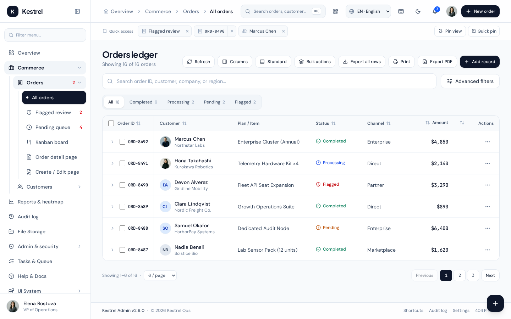
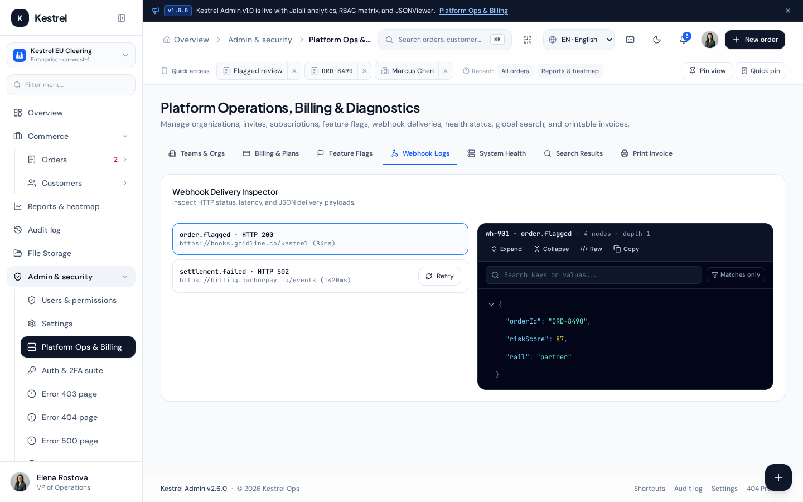
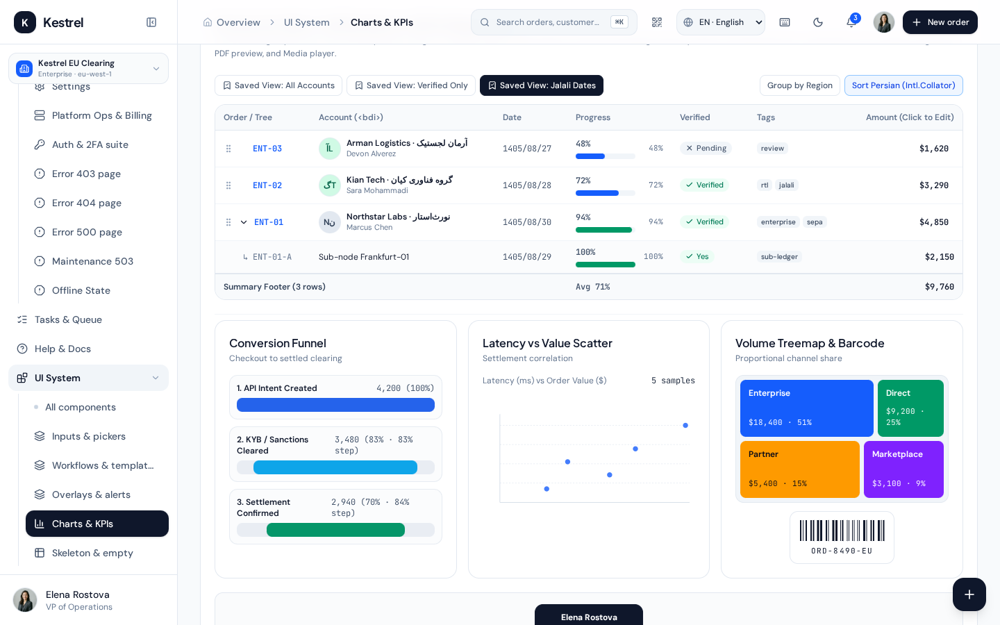
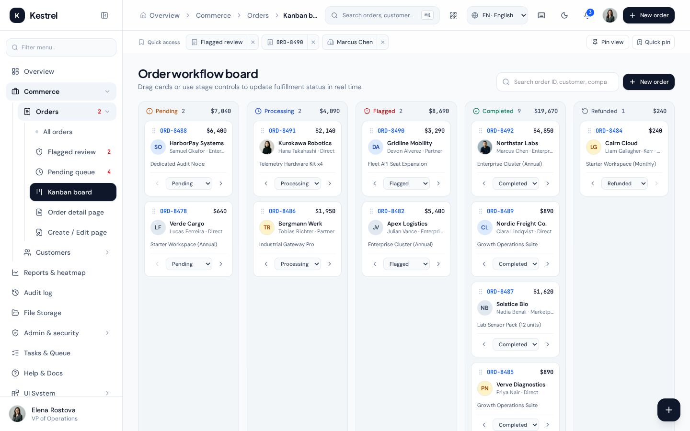
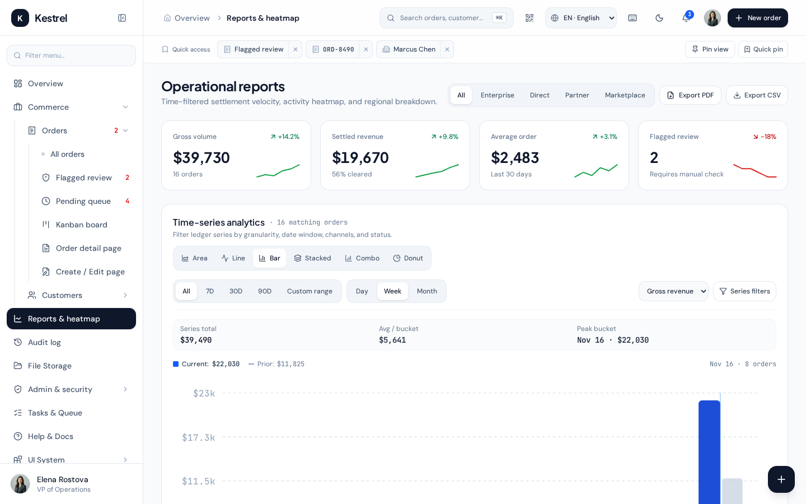
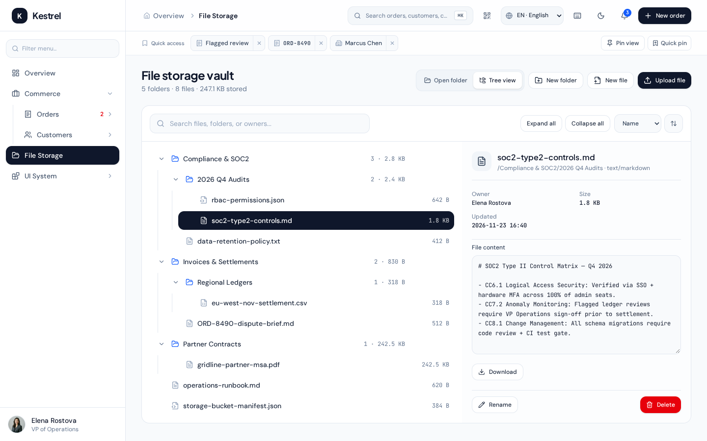
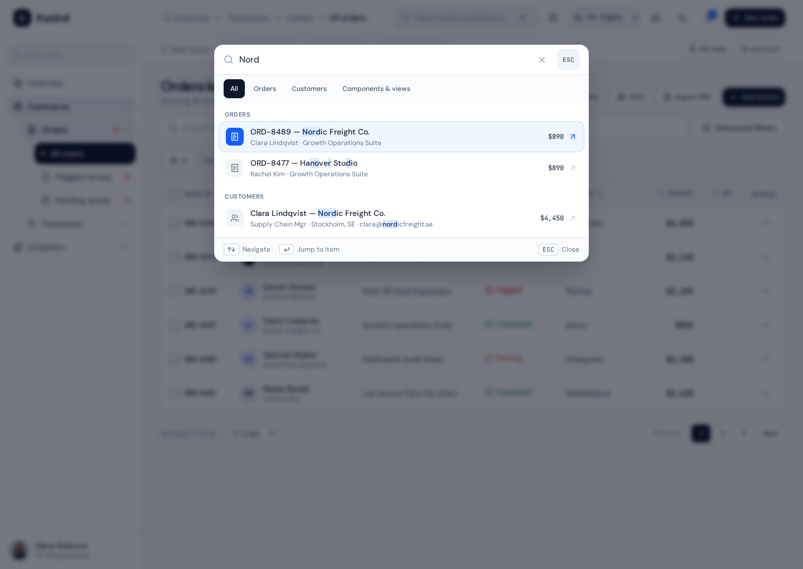
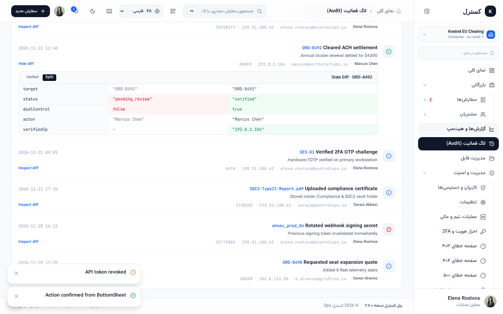
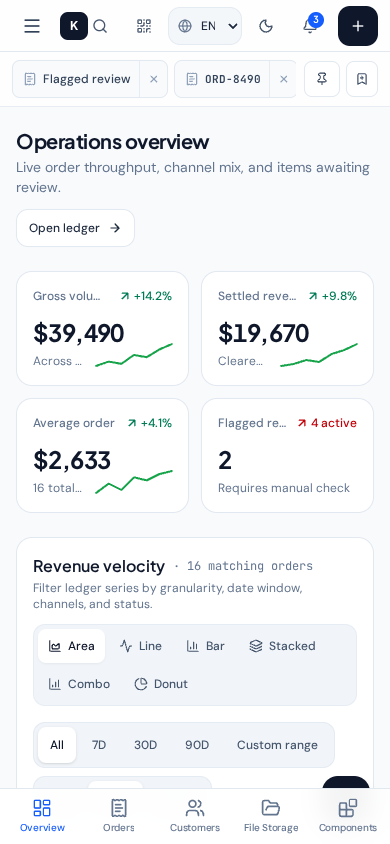

# Kestrel Admin `v1.0.0` — Enterprise Operations Dashboard & React UI System

A full-stack, mobile-first operations console and reusable React component architecture built with **React 19**, **TypeScript**, **Tailwind CSS v4**, **Vite 8**, and **Express**. Engineered around high-density desktop workflows, 44px mobile touch ergonomics, full **LTR / RTL internationalization** (`EN`, `AR`, `FA`, `ES`), Solar Hijri (`Jalali`) calendar & Persian normalization support, client-side PDF/Print document export, RBAC security administration, multi-tenant platform ops, virtual file storage with scoped modal picking, and schema-driven data tables.

> **Release `v1.0.0` Highlights:** Complete enterprise admin component suite, **Platform Operations, Billing & Diagnostics Hub** (`OperationsHubView`), multi-tenant `WorkspaceSwitcher` & `ImpersonationBanner`, `EnterpriseTable` (inline editing, tree rows, grouping, drag reorder, saved views, Jalali & `Intl.Collator('fa')` sorting), `AuditLogView` `DiffViewer`, `JSONViewer` debugger, `AdvancedCharts` (Funnel, Scatter, Treemap, Barcode, OrgChart), full Auth/2FA/Invite/Onboarding suite, custom enterprise hooks, and **`119` passing unit tests**.
> See **[How to Use Kestrel Admin (`docs/HOW_TO_USE.md`)](docs/HOW_TO_USE.md)** for full operator workflows and developer integration examples.


---

## Key Engineering Highlights

### 1. Backend-Driven `AutoDataGrid`, `EnterpriseTable` & Order Workflow Suite
- **Self-Describing API Contract (`GET /api/orders`)**: The Express server returns column definitions, filter schemas, row actions (including nested submenus), bulk actions, CRUD validation schemas, paginated rows, and dataset metrics in one payload.
- **Multi-Type Query Filtering**: Supports plain text search, numeric equality, numeric ranges, comma-separated IDs, Gregorian date ranges, date-time cutover ranges, static multi-select, and debounced AJAX multi-select (`GET /api/orders/options/:field`).
- **Column Pinning, Resizing, Density & Bulk Actions**: Toggle visibility, reorder/pin sticky columns, drag column dividers to resize widths, switch between Standard and Compact density, and execute scoped mutations or CSV downloads (`selected`, `current-page`, `current-filter`, `all-rows`).
- **Enterprise Grid Capabilities (`EnterpriseTable`)**: Demonstrates inline cell editing, grouped rows, expandable tree sub-rows, row drag-and-drop reordering, master-detail split panels, summary/footer aggregations, saved views, `<bdi>` bi-directional text isolation, Jalali date toggles, and `Intl.Collator('fa')` Persian sorting.
- **Kanban Status Board & Dedicated Detail/Form Views**: Transition orders across fulfillment/risk stages (`Pending`, `Processing`, `Flagged`, `Completed`, `Refunded`) in `KanbanView`, inspect full records in `OrderDetailPageView`, or create/edit with auto-saved drafts and unsaved-changes guards.

### 2. Multi-Type Time-Series Analytics, Reports & `AdvancedCharts`
- **Six Interactive SVG Chart Modes (`TimeSeriesAnalytics`)**: Switch seamlessly between **Area**, **Line**, **Bar**, **Stacked Bar**, **Composed (Bar + Line Dual Axis)**, and **Donut** breakdowns with hover inspection tooltips.
- **Dimensional Slice & Granularity Controls**: Filter live order datasets by date presets (`All`, `7D`, `30D`, `90D`, or custom range), bucket granularity (`Day`, `Week`, `Month`), metric (`Gross revenue`, `Settled`, `Orders`, `Avg order`), channels, and statuses with prior-period comparison deltas.
- **Operational Reports & Advanced Data Viz**: Inspect channel slices, regional throughput heatmaps (`HeatmapChart`), SLA `RadarChart`, utilization `GaugeChart` (`ReportsView`), plus `FunnelChart`, `ScatterChart`, `TreemapChart`, proportional `Barcode` SVG generator, and interactive `OrgChart`.

### 3. Print & Client-Side PDF Export Service
- **Programmatic PDF Generation (`jspdf` + `jspdf-autotable`)**: Exports both `AutoDataGrid` ledgers (landscape A4 with repeating headers and active filter summaries) and individual `OrderDetailDrawer` dispatch records (portrait A4 with embedded QR verification codes via `qrcode`).
- **Unicode & RTL Document Rendering**: Automatically switches to high-DPI HTML5 Canvas rasterization when exporting Arabic/Persian or RTL text so ligatures and bi-directional layout render crisply inside PDFs.
- **Print-Optimized Document Views**: Dedicated print preview modals, printable invoices with barcodes in `OperationsHubView`, and `@media print` layouts for physical export.

### 4. File Storage Vault & Scoped Modal Form Picker (`FileStorageView` & `FileStoragePickerModal`)
- **Dual Explorer Modes (`Open folder` & `Tree view`)**: Browse directories hierarchically in a split tree + inline file inspector or navigate folder-by-folder with breadcrumb trails, `Up one level` traversal, search, kind filters, and sorting.
- **Full CRUD, Drag-and-Drop Uploads & Inline File Editor**: Create nested folders and text/markdown/JSON/CSV files, upload files from disk (or drag & drop into folders), rename, delete recursively, download, and edit text/code files directly in the inspector.
- **Scoped Modal File Picker for Forms (`rootFolderId`)**: Mount `FileStoragePickerModal` or `StorageFormField` inside any form to select single/multiple files with an optional predefined root folder (`Partner Contracts`, `Invoices & Settlements`, `Compliance & SOC2`) that locks breadcrumbs, tree hierarchy, search, and upload destinations strictly to that subtree.

### 5. Platform Operations Hub, Security (RBAC), Audit Diff & Identity Suite
- **Platform Ops & Billing (`OperationsHubView`)**: Multi-tenant **Teams & Orgs** member invites, **Billing & Plans** quota meters, **Feature Flags** progressive rollout controls, **Webhook Logs** payload inspector powered by `JSONViewer`, **System Health** telemetry, **Global Search Results**, and **Print Invoice**.
- **Roles & Permission Matrix (`AccessControlView`)**: Manage role presets (`Super Admin`, `Operations Lead`, `Finance Analyst`, `Support Agent`), toggle per-module `View / Create / Edit / Delete` capabilities, guard UI controls via `<Can resource="..." action="...">`, and revoke active device sessions.
- **Audit Log with `DiffViewer`, Settings & Tasks Queue**: Inspect field-level before/after configuration and settlement diffs (`Unified` & `Split` views in `AuditLogView`), configure workspace preferences, monitor background job queues (`OperationsTasksView` & `BackgroundTaskManager`), and preview full Identity & Error screens (**Login, Register, Forgot/Change Password, OTP, 2FA Setup QR + Recovery Codes, Verify/Invite, Lockout, Onboarding Wizard**, plus `403 / 404 / 500 / Maintenance / Offline`).

### 6. Multi-Tenant Navigation Shell, Overlays & Hardware Tools
- **Shell & Multi-Tenant Context (`ShellOverlays.tsx`)**: Accessible `SkipLink` (`#main-content`), `WorkspaceSwitcher`, dismissible `AnnouncementBar`, `ImpersonationBanner` (`Impersonate Operator` from the profile menu), `OfflineReconnectingBanner`, `SessionTimeoutModal`, `ProductTourModal`, and `FeedbackWidget`.
- **Global Fuzzy Command Palette (`⌘K` / `Ctrl+K`) & Favorites + Recent Strip**: Fuzzy matching across orders, customers, routes, and component sections; pinned `FavoritesBar` entries plus automatic `Recent:` route pills persisted in `localStorage`.
- **Camera QR Scanner (`jsqr`) & Shortcuts (`?`)**: Live camera stream frame scanning (plus manual order/URI fallback) and multi-key Vim-style chords (`G` then `O/L/F/C/S/K`).

### 7. Reusable Component Kit, Persian/RTL Utilities & Custom Hooks
- **Data & Diagnostics**: **`JSONViewer`** (syntax highlighting, collapsible nodes, key/value search with Prev/Next navigation, `Matches only` filter, JSONPath copy, raw toggle), `DiffViewer`, `LogViewer`, `PDFPreviewCard`, `MediaPlayer`, `VirtualList`, `Timeline`, `CalendarView`, `ImageGallery` Lightbox, `CommentThread`, `DescriptionList`, and cell renderers (`CurrencyCell`, `DateCell`, `BooleanCell`, `AvatarCell`, `ProgressCell`, `LinkCell`, `TagCell`, `EllipsisText`, `BdiText`).
- **Extended Forms, Business Workflows & Pickers**: `TransferList`, `CascaderField`, `TreeSelectField`, `InputGroupAndMask`, `ConditionalAndMultiLangForm` (with bilingual `FA/EN` tabs and auto-save), `CronBuilder`, `DurationInput`, `IconPicker`, `MentionInput`, `LocationPicker`, `SignaturePad`, `Captcha`, **Gregorian / Date-Time / Dual-Calendar Range / Persian (Jalali) Date Pickers**, **WCAG Contrast Color Picker**, **WYSIWYG & Markdown Editors**, **Chunked `File.slice()` Multipart Uploader**, **Canvas Image Cropper**, `FormWizard`, `FormBuilder`, `ApprovalFlow`, `VersionHistory`, `TrashRecovery`, `AttachmentsList`, `TagCategoryManager`, `TemplateEditor`, `Popconfirm`, and `BottomSheet`.
- **Persian, Arabic & RTL Engineering (`src/utils/persianRtl.ts`) + Custom Hooks (`src/hooks/index.ts`)**: `normalizeDigits`, `normalizePersianText`, `matchesNormalizedQuery`, `sortByPersianField` (`Intl.Collator('fa')`), `computeJsonDiff`, `describeCronExpression`, `evaluateConditionalField`, plus `useIdle`, `useBeforeUnload`, `useWebSocket`, `useInterval`, `useEventListener`, `useDownload`, `useFormPersist`, and `useAbility`.

---

## Screenshots

### Operations Data Grid & Print / PDF Export
| Backend-Driven Data Grid (`AutoDataGrid`) | Order Dispatch Print & PDF Preview |
| :---: | :---: |
|  |  |

### Platform Ops Hub, Enterprise Table & Charts
| Platform Ops, Billing & Webhook `JSONViewer` | `EnterpriseTable` (Jalali + `Intl.Collator('fa')`) & Charts |
| :---: | :---: |
|  |  |

### Kanban Workflow, Reports, RBAC & `JSONViewer`
| Order Workflow Kanban Board | Operational Reports & Analytics |
| :---: | :---: |
|  |  |

| RBAC Users & Permission Matrix | Interactive `JSONViewer` Debugger |
| :---: | :---: |
|  |  |

### File Storage Vault & Scoped Modal Form Picker
| File Storage Tree View & Inline Inspector | Scoped Modal File Picker (`rootFolderId`) |
| :---: | :---: |
|  |  |

### Global Command Palette & Reusable UI Component Kit
| Fuzzy Command Palette (`⌘K`) | Form Controls, Date/Jalali Pickers & Uploader |
| :---: | :---: |
|  |  |

### Bi-Directional RTL (Arabic Dark & Persian Audit Diff) & Mobile Experience
| Persian RTL Audit Log & Split `DiffViewer` | Arabic RTL + Dark Mode Analytics |
| :---: | :---: |
|  |  |

| Mobile Responsive (`390×844`) |
| :---: |
|  |

---

## Tech Stack

| Layer | Technologies |
| :--- | :--- |
| **Frontend** | React 19, TypeScript, Tailwind CSS v4 (`@tailwindcss/vite`), Motion, Lucide React |
| **Backend & Tooling** | Express 4, Vite 8, `tsx` dev server middleware |
| **Documents & Media** | `jspdf`, `jspdf-autotable`, `qrcode`, `jsqr` |
| **Testing** | Node.js built-in test runner (`node:test`) across `src/utils/*.test.ts` (**119 unit tests**) |

---

## Keyboard Shortcuts

| Shortcut | Action |
| :--- | :--- |
| `⌘K` / `Ctrl+K` | Open global fuzzy Command Palette |
| `G` then `O` | Jump to Operations Overview |
| `G` then `L` | Jump to Orders Ledger (`AutoDataGrid`) |
| `G` then `F` | Jump to Flagged Review Queue |
| `G` then `C` | Jump to Customers Directory |
| `G` then `S` | Jump to File Storage Vault |
| `G` then `K` | Jump to Reusable UI Component Kit |
| `C` | Open Create New Order Modal |
| `Q` | Open Camera / Manual QR Code Scanner |
| `N` | Toggle Notifications Center |
| `D` | Toggle Light / Dark Theme |
| `?` | Open Keyboard Shortcuts Overlay |

---

## Backend API Endpoints (`server.ts`)

| Method | Endpoint | Purpose |
| :--- | :--- | :--- |
| `GET` | `/api/orders` | Returns full grid schema (columns, filter specs, actions, bulk actions, CRUD fields) + sorted/filtered/paginated rows |
| `GET` | `/api/orders/all` | Returns full order dataset for analytics and quick-inspection syncing |
| `GET` | `/api/orders/options/:field` | Debounced AJAX search options for `company`, `region`, and `planOrItem` |
| `GET` | `/api/orders/export` | Streams scoped CSV export (`selected`, `current-page`, `current-filter`, `all-rows`) matching visible columns |
| `POST` | `/api/orders` | Creates a new order or duplicates an existing record (`duplicateFromId`) with server validation |
| `PATCH` | `/api/orders/:id` | Partially or fully updates an order record |
| `DELETE` | `/api/orders/:id` | Deletes a single order record |
| `POST` | `/api/orders/bulk` | Executes bulk status changes or deletions across any grid scope |
| `GET` | `/api/storage` | Lists all file storage folders/files and aggregate vault summary stats |
| `POST` | `/api/storage/folder` | Creates a new folder under root or parent directory with duplicate validation |
| `POST` | `/api/storage/file` | Creates a new text/structured file with automatic MIME/extension inference |
| `POST` | `/api/storage/upload` | Uploads one or more files into a target directory |
| `PATCH` | `/api/storage/:id` | Renames a node or updates editable file contents |
| `DELETE` | `/api/storage/:id` | Recursively removes a file or folder subtree |

---

## Project Structure

```text
├── server.ts                      # Express API + Vite dev middleware entry point
├── docs/
│   ├── HOW_TO_USE.md              # v1.0.0 Operator & Developer Usage Guide
│   └── screenshots/               # 16 verified v1.0.0 application UI screenshots
└── src/
    ├── App.tsx                    # Root shell, routing state, workspace/impersonation, shortcuts & modals
    ├── components/
    │   ├── dashboard/             # CreateOrderModal, OrderDetailDrawer, AdvancedFilterDrawer
    │   ├── layout/                # AppShell, FavoritesBar, ShellOverlays (WorkspaceSwitcher, Banners, Feedback)
    │   ├── print/                 # OrderPrintModal, DataGridPrintModal, PrintPortal
    │   ├── storage/               # FileStoragePickerModal, StorageTreePanel, StorageInspectorPanel, StorageModals
    │   ├── ui/                    # AutoDataGrid, EnterpriseDataKit, AdvancedCharts, AdvancedFormKit,
    │   │                          # BusinessModulesKit, JSONViewer, TimeSeriesAnalytics, Pickers, QR, etc.
    │   └── views/                 # OverviewView, OrdersView, KanbanView, ReportsView, CustomersView,
    │                              # FileStorageView, AccessControlView, AuditLogView, SettingsView,
    │                              # OperationsHubView, OperationsTasksView, AuthErrorShowcaseView, ComponentKitView
    ├── data/                      # Initial operational datasets & notifications
    ├── hooks/                     # Custom hooks (useIdle, useBeforeUnload, useWebSocket, useFormPersist, useAbility, etc.)
    ├── i18n/                      # I18nContext & EN / AR / FA / ES translation dictionaries
    ├── services/                  # pdfExportService.ts & httpClient.ts
    ├── types/                     # TypeScript interfaces for admin, grid contracts, and storage nodes
    └── utils/                     # Pure decoupled engines & node:test suites (119 unit tests)
```

---

## Getting Started

### Prerequisites
- Node.js `>= 20`
- npm

### Installation & Local Development
```bash
# Install dependencies
npm install

# Start full-stack Express + Vite development server on http://localhost:3000
npm run dev
```

### Verification, Type Checking & Unit Tests
```bash
# Run all 119 decoupled unit tests (grid engine, JSONViewer, file storage & root scoping,
# time-series math, Jalali calendar, Persian/RTL normalization & diff, PDF layout, RBAC, etc.)
npx tsx --test src/utils/*.test.ts

# TypeScript strict check
npm run lint

# Production client bundle
npm run build
```
