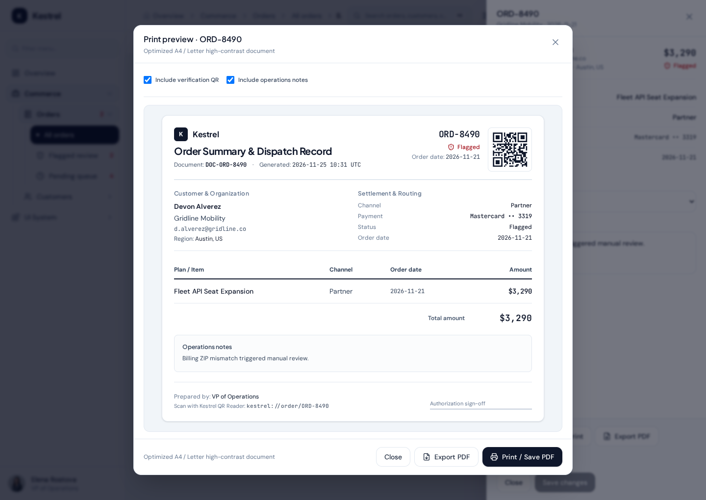

# Kestrel Admin — Enterprise Operations Dashboard & React UI System

A full-stack, mobile-first operations console and reusable React component architecture built with **React 19**, **TypeScript**, **Tailwind CSS v4**, **Vite 8**, and **Express**. Designed around high-density desktop workflows, 44px mobile touch ergonomics, full **LTR / RTL internationalization** (`EN`, `AR`, `FA`, `ES`), print/PDF document export, and schema-driven backend data tables.


---

## Key Engineering Highlights

### 1. Backend-Driven `AutoDataGrid` Engine
- **Self-Describing API Contract (`GET /api/orders`)**: The Express server returns column definitions, filter schemas, row actions (including nested submenus), bulk actions, CRUD validation schemas, paginated rows, and dataset metrics in one payload.
- **Multi-Type Query Filtering**: Supports plain text search, numeric equality, numeric ranges, comma-separated IDs, Gregorian date ranges, date-time cutover ranges, static multi-select, and debounced AJAX multi-select (`GET /api/orders/options/:field`).
- **Scoped Bulk Actions & Critical Confirmation**: Execute mutations or server-generated CSV downloads (`GET /api/orders/export`) across `selected`, `current-page`, `current-filter`, or `all-rows` scopes with confirmation dialogs for destructive operations.
- **Sticky Ergonomics & Mobile Card Fallback**: Sticky first (ID + checkbox) and trailing (Actions) columns on desktop; transforms automatically into touch-friendly cards with bottom-up filter/bulk action sheets on small viewports.
- **Persistent Column Settings**: Toggle visibility and order persisted cleanly across sessions.

### 2. Multi-Type Time-Series Analytics (`TimeSeriesAnalytics`)
- **Six Interactive SVG Chart Modes**: Switch seamlessly between **Area**, **Line**, **Bar**, **Stacked Bar**, **Composed (Bar + Line Dual Axis)**, and **Donut** breakdowns with hover inspection tooltips.
- **Dimensional Slice & Granularity Controls**: Filter live order datasets by date presets (`All`, `7D`, `30D`, `90D`, or custom date range), bucket granularity (`Day`, `Week`, `Month`), metric (`Gross revenue`, `Settled`, `Orders`, `Avg order`), channels, and statuses, with optional prior-period comparison deltas.

### 3. Print & Client-Side PDF Export Service
- **Programmatic PDF Generation (`jspdf` + `jspdf-autotable`)**: Exports both `AutoDataGrid` ledgers (landscape A4 with repeating headers and active filter summaries) and individual `OrderDetailDrawer` dispatch records (portrait A4 with embedded QR verification codes via `qrcode`).
- **Unicode & RTL Document Rendering**: Automatically switches to high-DPI HTML5 Canvas rasterization when exporting Arabic/Persian or RTL text so ligatures and bi-directional layout render crisply inside PDFs.
- **Print-Optimized Document Views**: Dedicated print preview modals and `@media print` layouts for physical export.

### 4. Navigation Shell, Productivity & Hardware Tools
- **Global Fuzzy Command Palette (`⌘K` / `Ctrl+K`)**: Substring and fuzzy character matching across orders, customers, routes, and component sections with highlighted match fragments and keyboard navigation.
- **Quick-Access Favorites Bar**: Pin frequently used views, flagged queues, specific orders, or customer profiles with `localStorage` persistence and automatic pruning when records are deleted.
- **Camera QR Scanner (`jsqr`)**: Live camera stream frame scanning (plus manual order/URI fallback) to jump straight to an order drawer from physical shipping labels or printed invoices.
- **Dynamic Breadcrumbs & Sequential Keyboard Shortcuts**: Multi-key Vim-style chords (`G` then `O/L/F/C/K`) and single-key actions (`C`, `N`, `D`, `Q`, `?`) with an interactive help modal.

### 5. Reusable React Component Kit (`38` Modular UI Primitives)
Includes custom-built **Gregorian Date Picker**, **Date-Time Picker**, **Dual-Calendar Date Range Picker**, **Solar Hijri / Persian (Jalali) Date Picker**, **WCAG Contrast-Checked Color Picker**, **Multi-Select & Async Multi-Select**, **Sanitized WYSIWYG Rich-Text Editor**, **Chunked `File.slice()` Multipart Uploader**, **Localized Number Formatter** (Latin / Eastern Arabic / Persian numerals), **Workflow Task/Project/Ticket Templates**, **Segmented Controls**, **Skeletons**, and **Toast Notification System**.

### 6. Internationalization, Bi-Directional RTL & Theme Architecture
- Full UI translation dictionary and logical CSS (`ms-*`, `me-*`, `ps-*`, `pe-*`, `start-*`, `end-*`) supporting **English (`en`)**, **Arabic (`ar` · RTL)**, **Persian (`fa` · RTL + Jalali)**, and **Spanish (`es`)** with light/dark mode parity.

---

## Screenshots

### Operations Data Grid & Print / PDF Export
| Backend-Driven Data Grid (`AutoDataGrid`) | Order Dispatch Print & PDF Preview |
| :---: | :---: |
|  |  |

### Global Command Palette & Reusable UI Component Kit
| Fuzzy Command Palette (`⌘K`) | Form Controls, Date/Jalali Pickers & Uploader |
| :---: | :---: |
|  |  |

### Full Bi-Directional RTL (Dark Mode) & Mobile Experience
| Arabic RTL + Dark Mode Analytics | Mobile Responsive (`390×844`) |
| :---: | :---: |
|  |  |

---

## Tech Stack

| Layer | Technologies |
| :--- | :--- |
| **Frontend** | React 19, TypeScript, Tailwind CSS v4 (`@tailwindcss/vite`), Motion, Lucide React |
| **Backend & Tooling** | Express 4, Vite 8, `tsx` dev server middleware |
| **Documents & Media** | `jspdf`, `jspdf-autotable`, `qrcode`, `jsqr` |
| **Testing** | Node.js built-in test runner (`node:test`) across `src/utils/*.test.ts` (**86 unit tests**) |

---

## Keyboard Shortcuts

| Shortcut | Action |
| :--- | :--- |
| `⌘K` / `Ctrl+K` | Open global fuzzy Command Palette |
| `G` then `O` | Jump to Operations Overview |
| `G` then `L` | Jump to Orders Ledger (`AutoDataGrid`) |
| `G` then `F` | Jump to Flagged Review Queue |
| `G` then `C` | Jump to Customers Directory |
| `G` then `K` | Jump to Reusable UI Component Kit |
| `C` | Open Create New Order Modal |
| `Q` | Open Camera / Manual QR Code Scanner |
| `N` | Toggle Notifications Center |
| `D` | Toggle Light / Dark Theme |
| `?` | Open Keyboard Shortcuts Overlay |

---

## Backend API Endpoints (`server.ts`)

| Method | Endpoint | Purpose |
| :--- | :--- | :--- |
| `GET` | `/api/orders` | Returns full grid schema (columns, filter specs, actions, bulk actions, CRUD fields) + sorted/filtered/paginated rows |
| `GET` | `/api/orders/all` | Returns full order dataset for analytics and quick-inspection syncing |
| `GET` | `/api/orders/options/:field` | Debounced AJAX search options for `company`, `region`, and `planOrItem` |
| `GET` | `/api/orders/export` | Streams scoped CSV export (`selected`, `current-page`, `current-filter`, `all-rows`) matching visible columns |
| `POST` | `/api/orders` | Creates a new order or duplicates an existing record (`duplicateFromId`) with server validation |
| `PATCH` | `/api/orders/:id` | Partially or fully updates an order record |
| `DELETE` | `/api/orders/:id` | Deletes a single order record |
| `POST` | `/api/orders/bulk` | Executes bulk status changes or deletions across any grid scope |

---

## Project Structure

```text
├── server.ts                      # Express API + Vite dev middleware entry point
├── docs/screenshots/              # Application UI screenshots
└── src/
    ├── App.tsx                    # Root shell, routing state, drawers, shortcuts & modals
    ├── components/
    │   ├── dashboard/             # OrderDetailDrawer, NewOrderModal, DataGridSection
    │   ├── layout/                # AppShell, FavoritesBar
    │   ├── print/                 # OrderPrintModal, DataGridPrintModal
    │   ├── ui/                    # 38 modular UI components (AutoDataGrid, Charts, Pickers, QR, etc.)
    │   └── views/                 # OverviewView, OrdersView, CustomersView, ComponentKitView
    ├── data/                      # Initial operational datasets & notifications
    ├── i18n/                      # I18nContext & EN / AR / FA / ES translation dictionaries
    ├── services/                  # pdfExportService.ts (client-side PDF generation)
    ├── types/                     # TypeScript interfaces for admin & backend grid contracts
    └── utils/                     # Pure decoupled engines & node:test suites (86 tests)
```

---

## Getting Started

### Prerequisites
- Node.js `>= 20`
- npm

### Installation & Local Development
```bash
# Install dependencies
npm install

# Start full-stack Express + Vite development server on http://localhost:3000
npm run dev
```

### Verification, Type Checking & Unit Tests
```bash
# Run all 86 decoupled unit tests (grid engine, time-series math, Jalali calendar, PDF layout, command palette, etc.)
npx tsx --test src/utils/*.test.ts

# TypeScript strict check
npm run lint

# Production client bundle
npm run build
```
